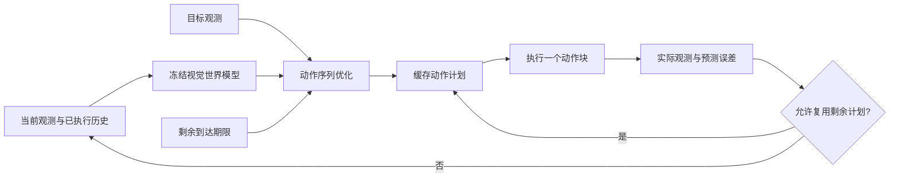

# Closed-Loop Planning with Frozen Visual World Models

**基于冻结视觉世界模型的闭环规划与计算效率研究**

[方法](docs/METHOD.md) · [实验与消融](docs/EXPERIMENTS.md) · [复现说明](docs/REPRODUCIBILITY.md) · [代码入口](archive/README.md) · [相关工作](docs/REFERENCES.md)

## Overview

本项目研究视觉世界模型在闭环执行中的目标时间设置、历史上下文与重规划频率。以 [Temporal Straightening](https://arxiv.org/abs/2603.12231v3) 的预训练模型为基础，在 PushT 仿真任务中分别评估到达期限、真实历史输入和预测误差门控的计划复用。主要配置保持世界模型权重冻结，通过改变动作规划和执行策略，分析任务成功率、环境交互成本与规划计算量之间的关系。

本仓库提供方法实现、实验源码、逐案例结果及来源记录。当前结果属于开发集上的描述性证据；完整重跑所需的外部模型、环境和任务资产见[复现说明](docs/REPRODUCIBILITY.md)。

## Method



| 组件 | 实现 | 评估问题 |
|---|---|---|
| Arrival deadline | 在初始 25 步内保持同一到达时刻，随后恢复原生目标函数 | 避免重规划反复后移到达时间是否有效？ |
| Temporal context | 使用最多三帧已观察到的图像/本体信息及连接它们的已执行动作 | 历史信息是否改善闭环表现？ |
| Feedback-gated reuse | 预测误差相对预计运动量较小时复用计划后缀，否则重新优化 | 在任务表现相近时能否减少规划计算？ |

每次重新规划进行 100 次动作梯度更新，每次执行 5 个原始动作。计划复用仍保留逐动作块反馈与成功检查。方法定义、门控公式和控制流程见 [METHOD.md](docs/METHOD.md)。

## Results

### 到达期限与历史上下文

WM108：同一批 50 个开发窗口，来自 20 条源轨迹。主要指标为 100 步内成功率与封顶交互步数，失败计为 100 步。

| 配置 | 成功数 ↑ | 成功率 ↑ | 平均封顶交互 ↓ | 25 步内成功（辅助） ↑ |
|---|---:|---:|---:|---:|
| Native | 44/50 | 88% | 38.7 | 16/50 |
| + Deadline | 45/50 | 90% | 33.4 | 43/50 |
| + History | 46/50 | 92% | 36.2 | 16/50 |
| + Deadline + History | 46/50 | 92% | **31.7** | 43/50 |

组合配置相对 Native 增加 2 个成功窗口，平均交互减少 7 步（18.1%）。短预算收益主要来自期限控制；历史输入增加了每轮计算，交互减少不等于运行加速。[完整结果](docs/EXPERIMENTS.md) · [逐案例表](results/wm108/all200_tasks.csv)

### 反馈门控的计划复用

WM114：同一开发池前 16 个窗口，来自 11 条轨迹，另批配对执行。B 表示 Deadline + History，BG 在 B 上加入计划复用。

| 配置 | 100 步内成功 ↑ | 平均封顶交互 ↓ | 总重规划次数 ↓ | 平均记录耗时（秒） ↓ |
|---|---:|---:|---:|---:|
| B | 14/16 | 35.625 | 114 | 134.695 |
| BG | 14/16 | 34.688 | 51 | 67.918 |

该批任务中成功数不变，重规划次数减少 55.3%，记录耗时减少 49.6%。计时包含统一诊断开销；这一批次不能与 WM108 合并成独立泛化结果。包括在线残差在内的全部四臂对照见 [EXPERIMENTS.md](docs/EXPERIMENTS.md)。

## Repository Structure

```text
.
├── archive/
│   ├── work/                  # 实验、模型连接、环境接口与分析源码
│   ├── source_manifest.json   # 源码来源与 SHA256
│   └── README.md              # 实现入口索引
├── docs/
│   ├── METHOD.md              # 方法定义与算法流程
│   ├── EXPERIMENTS.md         # 协议、主结果、消融与局限
│   ├── REPRODUCIBILITY.md     # 依赖、资产、接口与迁移步骤
│   ├── REFERENCES.md          # 相关工作与方法归属
│   ├── CODE_PROVENANCE.md     # 代码来源及许可
│   └── RESULTS_PROVENANCE.md  # 保存结果来源及文件摘要
├── results/{wm108,wm114}/     # 完整逐案例表、汇总与既有审计
├── licenses/                  # 第三方许可证参考副本
└── CITATION.cff               # 本代码仓库的引用元数据
```

保留实验编号和历史源码层次，以维持实现、协议与结果之间的对应关系。

## Reproducibility

1. 从[实验说明](docs/EXPERIMENTS.md)核对指标、窗口分组与各对照的预算。
2. 根据[源码索引](archive/README.md)定位方法实现与评估接口。
3. 根据[复现说明](docs/REPRODUCIBILITY.md)取得固定版本依赖、检查点及任务资产，再进行环境迁移。

当前发布包含 23 个历史 Python 源文件与保存结果，不包含检查点、完整任务缓存和锁定运行环境。源码保留协议及哈希检查；尚未验证在新克隆目录中的直接运行。详细资产状态集中记录在复现文档中。

## Related Work

直接模型与规划基础为 Temporal Straightening。到达时间问题与 [LePlanner](https://arxiv.org/abs/2609.13845v1) 相关，计划复用与 [AdaReP](https://arxiv.org/abs/2606.23079v2) 相关。本项目的贡献范围是具体系统实现与控制变量评估，尚无与这两种方法同协议比较的优越性结论。[版本与具体关系](docs/REFERENCES.md)

## Citation and License

引用此代码归档请使用 [CITATION.cff](CITATION.cff)，并注明使用的提交版本；采用底座或相关方法时，同时引用对应原论文。本仓库的引用元数据描述软件归档，不代表已发表论文。

第三方实现、模型和数据保留各自权利。本地代码尚未授予统一开源许可证，第三方许可证副本不自动适用于整个仓库。详见 [CODE_PROVENANCE.md](docs/CODE_PROVENANCE.md)。
